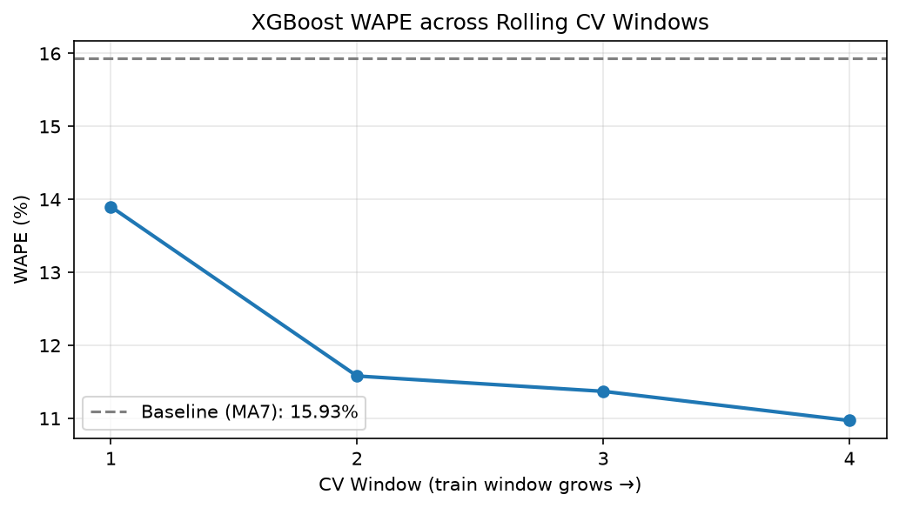
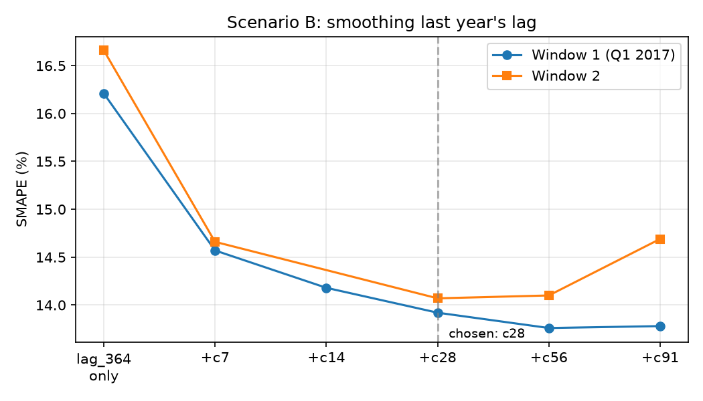

# Retail Demand Forecasting — Store × Item Daily Sales

Forecasting daily sales at the store–item level to support inventory and
replenishment decisions. A full pipeline from EDA through feature engineering,
model comparison, time-series cross-validation, and error analysis, covering
**two forecasting scenarios** that match two different kinds of business decisions.

**Data:** Kaggle *Store Item Demand Forecasting Challenge* (10 stores × 50 items,
daily sales, 2013–2017).

---

## Key Results

### Scenario A: short-horizon, rolling forecasts
- **XGBoost (Poisson objective) achieves WAPE 11.95%** (MAE 6.32, RMSE 8.24),
  evaluated with **4-fold rolling time-series cross-validation**.
- **~25% lower WAPE than the best naive baseline** (7-day moving average, 15.93%;
  last-week-same-day, 16.60%).
- **Ensembling gave no stable gain** across CV folds, so a single interpretable
  XGBoost was chosen over stacked models.
- **Feature importance cross-validated by two independent methods** (ElasticNet
  and XGBoost gain) consistently shows lag/rolling features dominate.
  
- **Error analysis**: forecast accuracy is driven by sales volume. High-volume
  items are predicted reliably (WAPE ~9%), low-volume items are inherently
  harder (WAPE ~18%); store-level differences are minor.

### Scenario B: full-quarter forecast with no recent actuals
- Forecasting the Kaggle 2018 Q1 test set in one shot (no actuals inside the
  horizon), **Kaggle late submission: Private SMAPE 12.89, Public SMAPE 14.29**
  (local validation: 13.9–14.1).
- **Smoothing last year's same-period sales** (28-day centered average) lowered
  validation SMAPE by **~14–16%** versus using the single-day `lag_364`.
  
- Details in [Scenario B](#scenario-b-long-horizon-forecast-kaggle-2018-q1) below.

---

## Two Forecasting Scenarios

The same data can serve two different decisions, and the **available information
differs**, so the model and features must differ too. The scenario is determined
by the business process (whether fresh actuals keep arriving during the forecast
horizon), not by the dataset.

| | **Scenario A: high-frequency decisions** | **Scenario B: medium/long-horizon decisions** |
|---|---|---|
| Forecast horizon | Next day / next week, refreshed as new data arrives | A full quarter ahead, in one shot |
| Recent actuals | Available (recent lags and rolling means can be computed) | Not available inside the horizon |
| Example decisions | Daily store replenishment; ordering for short-shelf-life goods; short-term staffing; inter-store stock transfers | Quarterly procurement and supplier contracts; seasonal inventory build-up; warehouse capacity and labor planning; budget and promotion calendars |
| Features | Calendar + lag (7/14/28/364) + rolling (7/14/30) | Calendar + last-year same-period features only (lag ≥ horizon) |
| Evaluation | 4-fold rolling CV, WAPE | Q1 hold-out windows + Kaggle late submission, SMAPE |

Scenario B is **not** a more efficient version of A: it is a harder situation
where the most informative recent signals are taken away, and the model must
recover as much as possible from calendar structure and last year's pattern.

---

## Project Structure
```
notebooks/
├── 01_Preview.ipynb                  # Data loading & overview
├── 02_EDA.ipynb                      # Exploratory analysis & business insights
├── 03_features.ipynb                 # Feature engineering (calendar, lag, rolling)
├── 04_models.ipynb                   # Model training & comparison
├── 05_benchmark.ipynb                # Rolling-window CV & error analysis (Scenario A)
├── 06_kaggle_submission.ipynb        # Scenario B feature-engineering experiments & validation
└── 06b_kaggle_submitted_version.ipynb  # The exact version submitted to Kaggle
```

Scenario B was developed on a dedicated branch (`kaggle-submission`) so that the
Scenario A results stayed untouched while experimenting.

---

## Approach & Key Findings (Scenario A)

**EDA.** Sales show a clear upward trend (2013→2017), strong yearly seasonality
(summer peaks), and a weekend effect (Sunday ≈ +50% vs Monday). A month × weekday
heatmap revealed an interaction: summer amplifies the weekday pattern.

**Feature engineering.** Calendar features (day-of-week, month, is_weekend),
lag features (7/14/28/364 days), and rolling means (7/14/30 days). The 364-day
lag (= 52 weeks) aligns year-over-year on the same weekday.

**Model selection.** Linear models (Ridge/ElasticNet) underperformed the naive
baseline, confirming non-linear/interaction effects and motivating tree models.
XGBoost, LightGBM, and CatBoost performed comparably; XGBoost was chosen for
maturity and interpretability. A **Poisson objective** was used to match the
non-negative count nature of sales.

**Evaluation.** 4-fold rolling-origin time-series CV (train always precedes
validation). Accuracy improved as the training window grew (WAPE 13.9% → 11.0%),
indicating more history yields better forecasts.

**Error analysis → business value.** Prediction accuracy is governed by item
sales volume, not store. This suggests a differentiated inventory policy:
replenish high-volume items tightly to forecast, keep larger safety buffers for
low-volume long-tail items.

---

## Scenario B: Long-Horizon Forecast (Kaggle 2018 Q1)

**Setup.** Predict all of 2018-01-01 to 2018-03-31 at once. The last known sales
are 2017-12-31, so any lag shorter than the horizon (lag_7, rolling means, etc.)
cannot be computed for most of the test period. Only features that look back
far enough are usable, i.e. last year's same period. This is a *direct*
multi-step strategy (one model, one pass) rather than recursive forecasting.

**Key idea: denoise last year's lag.** `lag_364` is a single day, so it carries
that day's random fluctuation along with the true level. Averaging a centered
window around the same date a year earlier keeps the seasonal alignment while
reducing noise. Calendar features (day-of-week, month, week-of-year) restore the
weekly pattern that the averaging smooths out.

**Validation.** Two Q1 hold-out windows, training strictly before each window
(window 1: train 2013–2016, predict Q1 2017). SMAPE (%), Poisson objective,
lower is better:

| Last-year lag feature | Window 1 | Window 2 |
|---|---|---|
| Single day (`lag_364`) | 16.21 | 16.66 |
| 7-day centered mean | 14.57 | 14.66 |
| 14-day | 14.18 | n/a |
| **28-day** | **13.92** | **14.07** |
| 56-day | 13.76 | 14.10 |
| 91-day | 13.78 | 14.69 |

- Performance improves steadily with the smoothing window up to ~28–56 days,
  then degrades at 91 days (seasonal variation gets averaged away). 28 and 56
  days are statistically indistinguishable across windows; **28 days was chosen**
  for retaining more seasonal detail and being more stable on the harder window.
- **Things that did not help** (and were therefore dropped): a nearer lag
  (`lag_91`) was unstable across windows, and combining multiple smoothing
  scales (7-day + 28-day) gave no gain.
- **Loss function:** Poisson vs. squared error differed by ≤ ~0.2 SMAPE with no
  consistent winner, so Poisson was kept for consistency with Scenario A. The
  Poisson choice was fixed before looking at the Kaggle score.
- **Final model:** XGBoost (Poisson), calendar features + `lag_364` +
  `lag_364_c28`, trained on all of 2013–2017.

**Kaggle result.** Late submission (the competition is closed, so this is not a
ranked leaderboard entry):

| | SMAPE |
|---|---|
| Public score | 14.29 |
| Private score | 12.89 |
| Local validation (2 windows) | 13.9 – 14.1 |

Local validation tracked the public score closely (gap ≈ 0.3), suggesting the
validation setup is reliable. Public and private scores cover different parts of
the test period, which explains their difference.

**Scenario A vs. B.** Without any recent lags, Scenario B reaches a WAPE of about
12.1% on window 1 versus 11.95% for Scenario A. These are different windows, so
the comparison is indicative only, but it shows that careful use of last year's
pattern recovers most of what the missing recent signals provide.

- Kaggle notebook: [long-term-forcasting-lag364-c28-smoothing](https://www.kaggle.com/code/xinyiyuan018/long-term-forcasting-lag364-c28-smoothing)
- `06_kaggle_submission.ipynb`: experiments and validation (how the setup was chosen)
- `06b_kaggle_submitted_version.ipynb`: the version actually submitted

---

## How to Run

```bash
# 1. Create environment
python -m venv .venv
source .venv/bin/activate        # Windows: .venv\Scripts\activate
pip install -r requirements.txt

# 2. Download data from Kaggle and place train.csv and test.csv in data/raw/
#    https://www.kaggle.com/c/demand-forecasting-kernels-only

# 3. Run notebooks in order (01 → 05 for Scenario A, then 06 for Scenario B)
#    06b is the Kaggle-hosted version and expects Kaggle's /kaggle/input paths.
```

Scenario B results were produced with XGBoost 3.4.1 on Kaggle; local runs used
3.2.0, so tiny numeric differences in predictions are expected.

---

## Limitations & Future Work

- Scenario B was validated on two Q1 windows and one Kaggle test period; a
  longer set of hold-out windows (other quarters) would give a firmer estimate.
- SMAPE weights every row equally, so low-volume items dominate it; WAPE is a
  better proxy for total stock quantity, and the two should be read separately.
- External signals (promotions, weather, holidays) could add information
  independent of sales history.
- Possible Scenario B extensions: a relative seasonal-index feature
  (last year's period vs. its yearly mean) and item-level trend estimates.

---

## Links
- GitHub: https://github.com/chloexinyiyuan/panel-forecast-kit
- Kaggle: https://www.kaggle.com/code/xinyiyuan018/long-term-forcasting-lag364-c28-smoothing
- Dataset: [Kaggle — Store Item Demand Forecasting Challenge](https://www.kaggle.com/c/demand-forecasting-kernels-only)